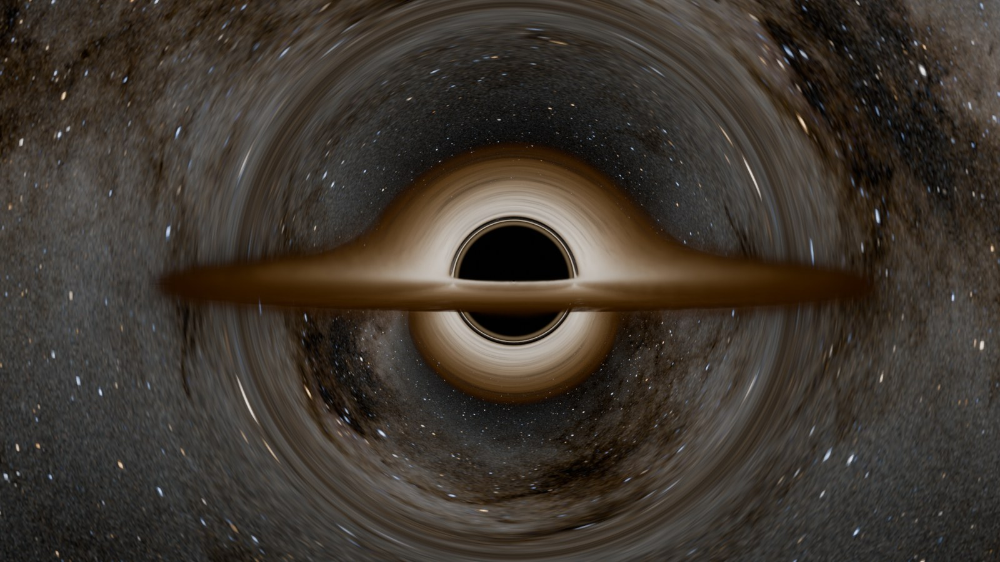
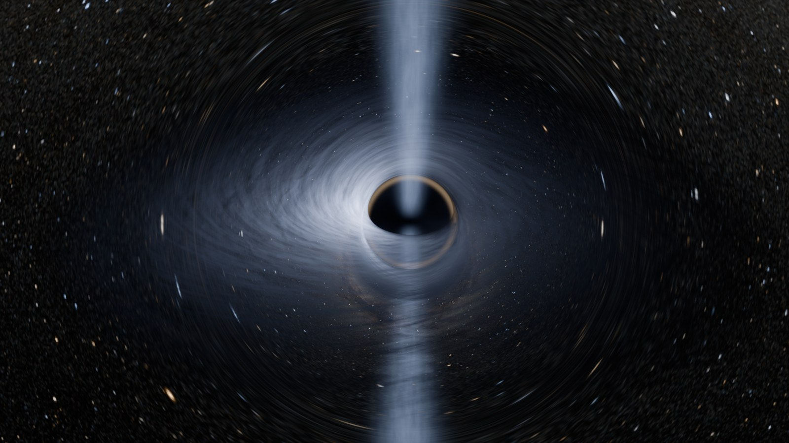
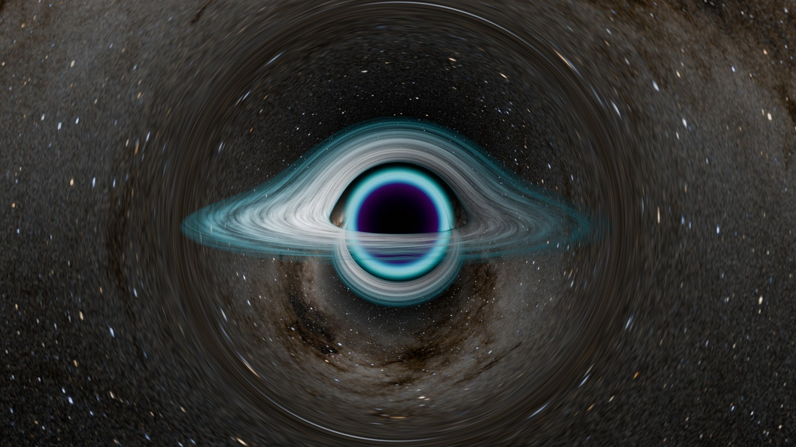

# Black Hole Studio


A Blender extension that adds a physically based black hole in one click. Light is bent by real general relativity, the accretion disk glows with true blackbody colours, Doppler beaming and gravitational redshift, and the lensed sky is the Milky Way. Every setting starts at real physics and every one can be pushed into a stylised look.

- **Blender:** 4.2 or newer (tested on 5.2)
- **Version:** 1.0.0
- **Licence:** GPL-3.0-or-later

## Documentation

| | |
|---|---|
| [**Quick Start**](docs/quick_start.md) ([PDF](docs/quick_start.pdf)) | Install, first render, every panel, presets, common tasks, troubleshooting and a reference of every setting. The PDF also ships inside the extension: click **?** in the sidebar. |
| [**Technical Breakdown**](docs/technical_breakdown.md) ([PDF](docs/technical_breakdown.pdf)) | How it works, section by section, with the maths: light bending, the lookup table, the disk, redshift, volumes, the OSL tracer and the Blender integration. |

## Install

1. Download `blackhole_studio-1.0.0.zip` from the [Releases](https://github.com/paraminder-dhiman/black-hole-studio/releases) page. Do not unzip it.
2. In Blender, open **Edit → Preferences → Get Extensions**, click the **⌄** arrow at the top right, choose **Install from Disk…** and pick the zip.
3. In the 3D Viewport, press **Shift + A → Black Hole**, or press **N** and use the **Black Hole** tab.

Adding a black hole also aims the camera at it, sets up a matching lensed World (your own World is kept) and configures Cycles.

## Features

- **Two render modes.**
  - **Fast:** exact Schwarzschild light paths, read from a precomputed lookup table by ordinary shader nodes. Runs in Cycles and Eevee, on CPU or GPU.
  - **Exact:** every ray traced with RK4 in an Open Shading Language shader (Cycles, CPU). Adds frame dragging and jets along curved paths.
  - Switching modes sets the render settings each one needs, and puts yours back afterwards.
- **Physically based disk.** Novikov–Thorne temperature profile, inner edge at the ISCO for any spin, exact orbital speeds, Doppler beaming and gravitational redshift.
- **Real lensing.** The shadow, the photon ring and the far side of the disk bent over the top all come straight from the light paths.
- **Fog, dust and thick disks.** Volumes integrated along the bent light path, so they are lensed too.
- **Relativistic jets**, with **Lens Scene Objects** (Cycles) to bend real objects behind the hole.
- **Fly-throughs.** The camera can go inside the influence sphere. **Hovering Observer** shows what a camera holding its position near the hole really sees.
- **Artistic control.** A physical ↔ gradient colour blend, glow, turbulence, dust lanes and a disk texture with Keplerian motion. The Realism panel lists every setting that departs from real physics, and **Make Physically Accurate** resets them all.
- **Six presets:** Physical Default, Gargantua (Interstellar), Event Horizon Telescope, Quasar, Neon Stylized and Pure Lensing.

| | |
|---|---|
|  |  |
|  |  |

## Known limitations

- Light paths are Schwarzschild. Spin is exact for the gas (ISCO, orbital speed, redshift) and approximate for light (shadow shift, frame dragging in Exact mode).
- Lens Scene Objects works in Cycles only, and rays bent by more than about 75° fall back to the sky image.
- Exact mode is set up for Cycles on the CPU.

The full list is in the [Technical Breakdown](docs/technical_breakdown.md#known-limitations).

## Development

```
python -m pytest tests                                    # physics tests (numpy + pytest)
python tests/reference_tracer.py preview.png              # NumPy reference render
blender -b --python scripts/smoke_test.py -- <out_dir>    # end-to-end test inside Blender
```

To build the extension zip:

```
cd blackhole_studio
blender --command extension validate
blender --command extension build --output-dir ../dist
```

## Credits

- **Milky Way sky:** [*Deep Star Maps 2020*](https://svs.gsfc.nasa.gov/4851), NASA's Scientific Visualization Studio (visualizations by Ernie Wright, USRA), built from the Hipparcos-2 and Tycho-2 catalogues and ESA's Gaia Data Release 2. Public domain.
- **Accretion disk texture:** made in Blender by the author, released into the public domain (CC0 1.0).
- **Physics references:** Bardeen, Press & Teukolsky (1972), Novikov & Thorne (1973), Synge (1966). See the [Technical Breakdown](docs/technical_breakdown.md#references) for the full list.

## Licence

Copyright © 2026 Paraminder Dhiman.

Black Hole Studio is free software, released under the [GNU General Public License v3.0 or later](LICENSE).
