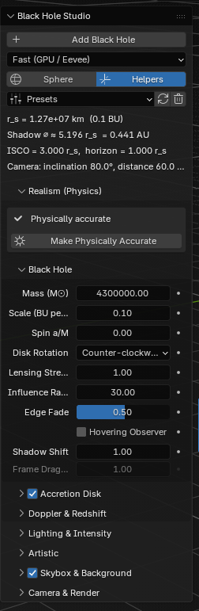
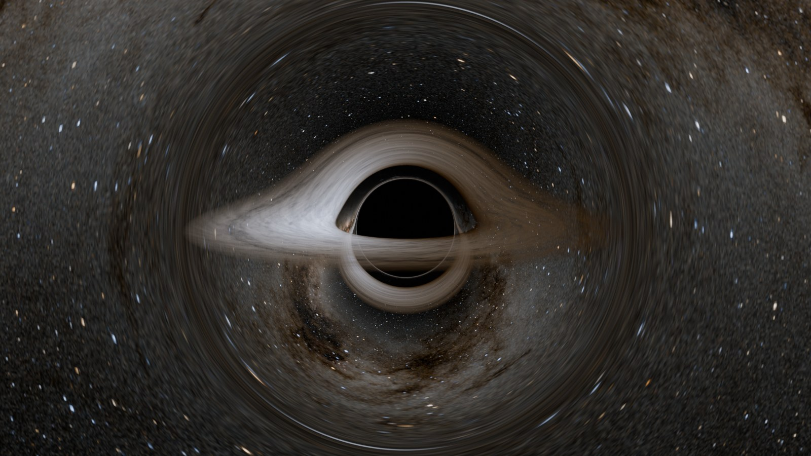
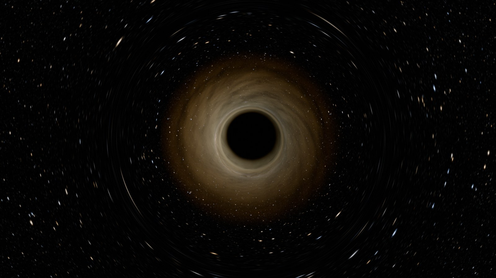

# Black Hole Studio · Quick Start

Version 1.0.0 · Oct 28, 2026 · Paraminder Dhiman

Black Hole Studio adds a physically based black hole to Blender in one click: real light bending from general relativity, a glowing accretion disk, optional fog, dust and jets, and a lensed sky behind it. Every setting starts at real physics, and every one can be pushed into a stylised look.

This guide takes about ten minutes from install to your first render. Section 7 has recipes for common tasks, and the appendix lists every setting.

## 1 · Requirements

|  | Fast mode (default) | Exact mode |
| --- | --- | --- |
| Blender | 4.2 or newer (tested on 5.2) | 4.2 or newer (tested on 5.2) |
| Render engine | Cycles or Eevee | Cycles only |
| Device | CPU or GPU | CPU (needs Open Shading Language) |
| Viewport preview | Yes | Yes, in Cycles |

No extra Python packages or downloads are needed. The disk texture and the Milky Way sky come with the extension.

## 2 · Install

**From inside Blender (recommended)**

1. Open **Edit → Preferences → Get Extensions**.
2. Search for **Black Hole Studio** and click **Install**.

**From a downloaded zip**

1. Open **Edit → Preferences → Get Extensions**.
2. Click the small **⌄** arrow at the top right of the window, then **Install from Disk…**
3. Choose `blackhole_studio-1.0.0.zip` without unzipping it, and click **Install from Disk**.

You can also drag the zip onto the Blender window. Either way, make sure **Black Hole Studio** is ticked in the list, then close Preferences.

## 3 · Your first black hole

1. Start a new scene with **File → New → General**.
2. With the mouse over the 3D viewport, press **Shift + A** and choose **Black Hole** at the bottom of the menu.
3. A small **Add Black Hole** panel appears at the bottom left of the viewport. Expand it to see four options, all on by default:
   - **Render Mode:** Fast or Exact (see section 4).
   - **Starfield World:** gives the scene a matching sky World called *BHS Sky*. Your current World is kept, and you can switch back to it in World Properties.
   - **Frame Camera:** points the scene camera at the black hole, creating a camera if there isn't one.
   - **Configure Render:** switches to Cycles with suitable samples, bounces and colour settings.
4. Press **N** to open the sidebar, then click the **Black Hole** tab on its right edge.
5. Press **Numpad 0** to look through the camera.
6. Switch the viewport to **Rendered** shading: press **Z** and choose **Rendered**.
7. Press **F12** for a full render.

In Solid shading the lens sphere is invisible on purpose. The black hole only appears in Rendered view and in renders.

## 4 · Fast or Exact?

Use **Fast** for almost everything. It reads the light paths from a precomputed table, works in Cycles and Eevee on CPU or GPU, and renders almost the same image as Exact.

|  | Fast | Exact |
| --- | --- | --- |
| How it bends light | Exact paths read from a precomputed table | Every pixel traced step by step in an OSL shader |
| Engines | Cycles, Eevee | Cycles CPU with Open Shading Language |
| Speed | Fast, interactive viewport | Slower, CPU only |
| Jets | Straight-line approximation | Bent along the real light path |
| Frame dragging (spin) | Not available | Available |

Switch with the dropdown at the top of the sidebar. The render settings follow automatically. Choosing Exact switches the scene to Cycles on the CPU with Open Shading Language on, and remembers your previous engine and device. Choosing Fast again turns Open Shading Language off and puts your engine and device back, unless another black hole in the scene is still in Exact. If you later change the render engine by hand while in Exact mode, a red box appears with a **Configure Render Settings** button that fixes it in one click.

## 5 · The sidebar, panel by panel

Everything lives in the **Black Hole** tab of the 3D viewport sidebar (press **N**). Select the black hole, or any of its parts, to see its settings.

### Main panel

- **Add Black Hole:** adds a new one at the 3D cursor.
- **Render mode dropdown:** Fast or Exact.
- **Sphere / Helpers:** show the influence sphere's wireframe, and the horizon and photon-sphere markers. Neither affects the render.
- **Presets:** ready-made looks (section 6). The two small buttons next to it rebuild the shader and remove the black hole cleanly.
- **Info lines:** the black hole's real size for its mass, the shadow's size, the innermost stable orbit (ISCO) and the horizon, plus the camera's angle and distance. Warnings appear here if the camera is inside the horizon or very close in Fast mode.
- **"Disk inner edge limited to 1.60 r\_s":** appears when a fast spin pushes the real ISCO below 1.6 r\_s. The disk stops at 1.6 r\_s because the light paths are calculated for a non-spinning hole.

### Realism (Physics)

The top box lists every setting that differs from real physics. **Make Physically Accurate** resets them all and keeps your texture, fog, sky and camera.

- **Black Hole:** mass, scale, spin, lensing strength, influence radius, edge fade and the hovering observer. Exact mode adds the step settings.
- **Accretion Disk:** inner and outer edge, temperature, opacity and thickness.
- **Doppler & Redshift:** how much the disk's motion and gravity shift its colour and brightness.

### Lighting & Intensity

All the brightness controls in one place: disk, jets, ring glow, fog glow, sky and background, plus the disk's light on nearby objects and the camera exposure.

### Artistic

The colour blend between real blackbody colours and your own three-colour gradient, plus hue and saturation. Its sub-panels:

- **Glow:** a glow along the shadow's edge and inside it, plus **Add Glow & Lens Effects** for compositor bloom and slight chromatic aberration.
- **Disk Texture:** the image that shapes the disk, its strength, scale and how it moves over time.
- **Fog & Dust:** glowing haze and dark dust around the hole (section 7).
- **Turbulence & Edges:** the procedural streaks and their spiral, dust lanes and soft edges.
- **Relativistic Jets:** beams along the spin axis.

### Skybox & Background

The sky image the black hole bends, its brightness and rotation, optional procedural stars on top, **Lens Scene Objects** (section 7) and **Use Matching World**.

### Camera & Render

Inclination and distance with **Frame Camera**, exposure and look, and **Preview** / **Final** render settings.

## 6 · Presets

A preset first resets the look to the defaults, then applies its own changes. It never touches your sky image and its brightness and rotation, disk texture, mass, scale, camera distance, Edge Fade, Hovering Observer, Lens Scene Objects, scene lighting or Volume Quality. The camera's inclination does change for some presets: press **Frame Camera** afterwards to move the camera there.

All images below are Fast mode, rendered at 16 samples with denoising.

### Physical Default

A thin disk around a non-spinning hole, seen from 80°. Colours are true blackbody colours, and Doppler beaming and gravitational redshift are at their real values. This is the starting point and the most physically honest look.

### Gargantua (Interstellar)

A spinning hole (spin 0.6) seen nearly edge-on at 86°, with warm artistic colours and a light haze of fog. As in the film, Doppler beaming and redshift are switched off, so both sides of the disk are equally bright.

### Event Horizon Telescope

A fast-spinning hole (spin 0.9) seen almost face-on at 17°, like the published image of M87\*. The disk is thick, small and partly see-through, the photon ring is boosted and the stars are off.

### Quasar

A near-maximum spin (0.95), a very hot 30,000 K disk with blue-white light, bright jets along the spin axis and a glowing fog halo, seen from 65°.

### Neon Stylized

A fully artistic look: a cyan-to-violet gradient, strong ring and horizon glow, sharp spiral streaks, dust lanes and a violet procedural nebula.

### Pure Lensing

No disk at all. Only the shadow, a thin photon-ring glow and a dense star field bent around the hole. Useful for studying the lensing itself, or as a base for your own look.

## 7 · Common tasks

### Animate the disk

There is nothing to keyframe. The disk is already driven by the frame number, so press **Space** to play.

- **Texture Motion** (Disk Texture): **Keplerian** makes inner parts orbit faster, so the pattern winds into spirals over time. **Rigid** turns it as one piece. **Static** stops it.
- **Texture Speed** and **Rotation Speed** (Turbulence & Edges) set how fast. Negative values reverse the direction.
- Animated fog moves with **Swirl Speed**.

### Change the camera angle or fly in

Set **Inclination** (0° looks down the spin axis, 90° is edge-on) and **Distance** in Camera & Render, then press **Frame Camera**. You can also move the camera by hand: the info line in the main panel always shows its real angle and distance.

To fly in, animate the camera towards the hole. The camera may go inside the influence sphere. Close in, turn on **Hovering Observer** to see what a camera holding its position would really see: a brighter, bluer sky and a slightly smaller shadow.

### Add fog and dust

Tick **Fog & Dust** (Artistic). **Glow** makes a haze lit by the disk, **Dust Absorption** darkens what is behind it, and **Halo** blends from a thin layer along the disk to a round cloud. The fog follows the bent light paths, so it is lensed too.

*Left: fog off · Right: fog on*

Fog roughly triples render time or more. Use **Volume Quality: Draft** while you work and raise it for the final render.

### Make a thick disk

Raise **Thickness (H/r)** in the Accretion Disk panel. Real thin disks are between 0.01 and 0.1. Above 0.1 the disk becomes a puffy torus. **Flare** makes it thicker further out. Thick disks look cleaner at **Volume Quality: High**.

*Left: thin disk · Right: Thickness 0.1, edge-on*

### Bend real scene objects (Cycles)

Tick **Lens Scene Objects** (Skybox & Background). Objects behind the black hole are now seen through the lens: a planet behind it shows up as a bent arc around the shadow. This works in Cycles only. Without it, only the sky image is bent.

### Light the scene with the disk

**Disk Lights the Scene** (Lighting & Intensity, on by default) adds an invisible light shaped like the disk, so nearby ships or planets pick up its glow. **Scene Light Strength** sets how bright.

### Use your own sky or disk image

Click the folder icon next to **Skybox** and pick any equirectangular image (2:1, ideally EXR or HDR). Turn **Use Skybox** off to use the procedural stars and nebula instead. For the disk, open a top-down grayscale image in **Disk Texture**: its edge matches the disk's outer radius.

### Match the World background

The lens sphere bends the sky, but the World outside it is your own. Press **Use Matching World** so the background outside the sphere matches. Your current World is kept (saved with a fake user), so you can switch back in the World properties.

### Change the size

**Scale (BU per r\_s)** sets how big the hole is in Blender units. **Mass** only changes the real-world size shown in the panel: every black hole looks the same when measured in r\_s.

### Add bloom

Press **Add Glow & Lens Effects** (Glow) to add soft glare and slight chromatic aberration in the compositor.

## 8 · Troubleshooting

**I only see a grey sphere.** The viewport is in Solid view. Switch to Material Preview or Rendered (**Z** menu).

**Exact mode renders black or pink.** Exact mode needs Cycles on the CPU with Open Shading Language turned on. Choosing Exact sets this up for you, but changing the render engine or device by hand afterwards undoes it. Press **Configure Render Settings** in the main panel, or use Fast mode.

**"Disk fades out at … r\_s (Influence Radius)".** The disk or fog reaches past 90% of the influence sphere and are being faded out. Raise **Influence Radius** to the number shown, or make them smaller.

**"Disk inner edge limited to 1.60 r\_s".** This is information, not an error. At very high spin the real ISCO is closer in than the light paths are calculated for, so the disk stops at 1.6 r\_s.

**There is a visible circle or seam in the sky.** Raise **Edge Fade** so the bending fades out more gradually, or raise **Influence Radius**. If the seam is between the sphere and the World, press **Use Matching World**.

**Faint streaks in a thick disk or fog.** Raise **Volume Quality** to High (24) or more. Render time grows with it.

**Renders are slow.** Fog and thick disks cost the most. Use Draft quality and the **Preview** render settings while working. In Exact mode, lower **Steps / Orbit** for previews.

**Objects behind the hole aren't bent.** **Lens Scene Objects** works in Cycles only. In Eevee only the sky is bent.

**"Camera is inside the event horizon".** The camera is closer than the horizon, where nothing meaningful can be rendered. Move it out.

**"Inside the photon sphere: Exact mode is more accurate".** Fast mode is built for cameras outside 1.5 r\_s. It still renders, but Exact mode traces those paths properly.

**Something looks out of date after changing settings.** Press the **Rebuild Shader** button (the circular arrow next to the presets).

**The sky is too dark or too bright.** **Skybox Brightness** changes only the image. **Background Brightness** changes everything behind the hole, World included. **Camera Exposure** changes the whole frame.

## 9 · Credits and licence

**Code:** Black Hole Studio is free software under the GNU General Public License v3.0 or later (GPL-3.0-or-later).

**Milky Way sky:** from *Deep Star Maps 2020*, NASA's Scientific Visualization Studio (visualizations by Ernie Wright, USRA). The star maps are built from the Hipparcos-2 and Tycho-2 catalogues and ESA's Gaia Data Release 2. NASA imagery is in the public domain.

**Accretion disk texture:** made in Blender by the author for this add-on and released into the public domain (CC0 1.0). Anyone may use it for anything.

**Physics:** the light paths follow the Schwarzschild solution of general relativity. The disk's inner edge uses Bardeen, Press and Teukolsky (1972) and its temperature profile Novikov and Thorne (1973). The full maths is in the Technical Breakdown.

Source code, issues and the Technical Breakdown: [github.com/paraminder-dhiman/black-hole-studio](https://github.com/paraminder-dhiman/black-hole-studio)

## 10 · Appendix: every setting

Distances are in r\_s, the Schwarzschild radius (the size of the event horizon of a non-spinning hole). "Physical" means the value real physics gives.

### Main panel

| Setting | Default | What it does |
| --- | --- | --- |
| Render Mode | Fast | Fast: lookup table, GPU and Eevee. Exact: traces every ray in Cycles OSL on the CPU, adds frame dragging and curved jets. Switching also sets the render settings each mode needs. |
| Sphere | Off | Draws the influence sphere's wireframe. It always renders. |
| Helpers | On | Draws the horizon, photon-sphere and disk-light markers. |

### Black Hole

| Setting | Default | What it does |
| --- | --- | --- |
| Mass (M☉) | 4.3 million | Real-world size shown in the panel only. |
| Scale (BU per r\_s) | 0.1 | Blender units per r\_s. |
| Spin a/M | 0 | −0.998 to 0.998. Moves the ISCO and changes orbital speeds. Positive means the disk turns with the hole. |
| Disk Rotation | Counter-clockwise | Direction seen from +Z. |
| Lensing Strength | 1 (physical) | 0 turns bending off. |
| Influence Radius | 30 | Size of the lens sphere. Disk and fog must fit inside 90% of it. |
| Edge Fade | 0.5 | Outer part of the sphere where bending fades to zero, so there is no seam. |
| Hovering Observer | Off | Show what a camera holding still near the hole would see: bluer, brighter light and a slightly smaller shadow. |
| Shadow Shift | 1 | Sideways shift of the shadow for spinning holes (approximation). |
| Frame Dragging | 1 | Exact mode: twist of light paths by the spinning hole (approximation). |
| Steps / Orbit | 256 | Exact mode: accuracy of each ray. |
| Max Orbits | 3 | Exact mode: how many times a ray may circle the hole. |

### Accretion Disk

| Setting | Default | What it does |
| --- | --- | --- |
| Accretion Disk | On | Shows the disk. |
| Inner Edge at ISCO | On | Puts the inner edge at the innermost stable orbit for the spin. |
| Inner Radius | 3 | Used when the option above is off. Minimum 1.6. |
| Outer Radius | 12 | Outer edge. |
| Peak Temperature (K) | 7000 | Hottest temperature. Sets the blackbody colour. |
| Temperature Falloff | 0.75 (physical) | How fast it cools outwards. |
| Opacity | 0.95 | How much the disk hides what is behind it. |
| Thickness (H/r) | 0 | 0 is infinitely thin. Real thin disks 0.01 to 0.1. |
| Flare | 0 | Thicker further out. |
| Volume Quality | Standard (16) | Samples for fog and thick disks. Higher is smoother and slower. |

### Doppler & Redshift

| Setting | Default | What it does |
| --- | --- | --- |
| Doppler Beaming | 1 (physical) | Brightening of the side moving towards you. 0 is off. |
| Gravitational Redshift | 1 (physical) | Dimming and reddening near the hole. 0 is off. |
| Color Shift | 1 | How much these shifts change colour. Brightness always shifts. |
| Beaming Exponent | 4 (physical) | Strength of the brightness change. 3 is the other common convention. |

### Lighting & Intensity

| Setting | Default | What it does |
| --- | --- | --- |
| Disk Brightness | 1 | Overall disk brightness. |
| Jet Brightness | 1 | Jets only. |
| Ring Glow | 0 | Glow along the shadow's edge. |
| Fog Glow | 2 | Light the fog scatters. |
| Background Brightness | 1 | Everything behind the hole, World included. |
| Skybox Brightness | 2.5 | The sky image only. |
| Disk Lights the Scene | On | Invisible light shaped like the disk. |
| Scene Light Strength | 1 | Brightness of that light. |
| Camera Exposure | 0 | Blender's scene exposure. |

### Artistic

| Setting | Default | What it does |
| --- | --- | --- |
| Physical Color | 1 | 1 is blackbody colours, 0 is your gradient. |
| Hot / Warm / Cool | white, orange, deep red | Your three-colour gradient, hottest to coolest. |
| Hue Shift | 0 | Rotates the hue of disk, jets and glow. |
| Saturation | 1 | Saturation of disk, jets and glow. |

### Glow

| Setting | Default | What it does |
| --- | --- | --- |
| Einstein Ring Glow | 0 | Glow hugging the shadow's edge. |
| Glow Width | 0.15 | Width in r\_s. |
| Ring Color | warm orange | Colour of the ring glow. |
| Horizon Glow | 0 | Glow inside the shadow's edge. |
| Horizon Color | orange | Its colour. |
| Photon Ring Boost | 1 | Brightens the thin secondary images of the disk. |

### Disk Texture

| Setting | Default | What it does |
| --- | --- | --- |
| Disk Texture | On | Use an image for the disk's pattern. |
| Texture | bundled disk | Top-down grayscale image. Its edge is Outer Radius × Texture Scale. |
| Density Influence | 1 | How much the image controls opacity. |
| Brightness Influence | 0.5 | How much it controls brightness. |
| Texture Contrast | 1 | Above 1 deepens the dark gaps. |
| Texture Scale | 1 | Image size relative to the outer radius. |
| Texture Rotation | 0° | Fixed rotation. |
| Texture Motion | Keplerian | Static, Rigid, or Keplerian (inner parts faster). |
| Texture Speed | 1 | Speed of the motion. Negative reverses. |

### Fog & Dust

| Setting | Default | What it does |
| --- | --- | --- |
| Fog & Dust | Off | Volumetric haze around the hole, lensed too. |
| Density | 0.05 | Amount of fog. |
| Glow | 2 | Light scattered from the disk. |
| Dust Absorption | 1 | How much it dims what is behind. |
| Match Disk Thickness | Off | Use the disk's thickness as the fog height. |
| Height (H/r) | 0.15 | Thickness of the haze. |
| Halo | 0.25 | 0 hugs the disk, 1 is a round cloud. |
| Halo Falloff | 1.5 | How quickly the halo thins outwards. |
| Inner / Outer Radius | 2 / 22 | Where the fog starts and ends. |
| Edge Falloff | 0.5 | Softness of the outer edge. |
| Clumpiness | 0.6 | 0 smooth, 1 clumpy. |
| Clump Scale / Detail | 0.35 / 4 | Size and detail of the clumps. |
| Swirl Speed | 1 | Orbital speed of the fog. |
| Fog Color | dusty brown | Colour of the dust. |
| Fog Color Mix | 0.5 | 0 is lit by the disk's colour, 1 is Fog Color. |

### Turbulence & Edges

| Setting | Default | What it does |
| --- | --- | --- |
| Turbulence Contrast | 0.35 | 0 smooth, 1 clumpy streaks. |
| Turbulence Scale | 1.5 | Size of the structures. |
| Turbulence Detail | 5 | Layers of detail. |
| Turbulence Roughness | 0.55 | Strength of fine detail. |
| Spiral Shear | 2 | How tightly the streaks wind. |
| Rotation Speed | 0.5 | How fast the streaks orbit. |
| Dust Lanes / Lane Frequency | 0 / 4 | Dark rings and how many per r\_s. |
| Inner / Outer Softness | 0.05 / 0.3 | Fade width at each edge. |

### Relativistic Jets

| Setting | Default | What it does |
| --- | --- | --- |
| Relativistic Jets | Off | Beams along the spin axis. |
| Length | 20 | Length in r\_s. |
| Opening Angle | 5° | Half-width of the cone. |
| Base Width | 0.4 | Width at the base. |
| Intensity | 1 | Brightness. |
| Turbulence | 0.5 | Knots along the jet. |
| Color | blue | Jet colour. |

### Skybox & Background

| Setting | Default | What it does |
| --- | --- | --- |
| Use Skybox | On | Use a sky image. Off: procedural stars. |
| Skybox | Milky Way (NASA) | Equirectangular 2:1 image. |
| Skybox Rotation | 0° | Turns the sky around Z. |
| Stars Over Skybox | 0 | Adds the procedural stars on top. |
| Star Density / Brightness / Size | 220 / 1 / 0.06 | Procedural stars. |
| Nebula / Nebula Color | 0.15 / blue | Procedural nebula. |
| Lens Scene Objects | Off | Bend real objects behind the hole (Cycles). |
| Drive World Background | On | Keep the World in sync with these settings. |

### Camera & Render

| Setting | Default | What it does |
| --- | --- | --- |
| Inclination | 80° | Angle from the spin axis. 90° is edge-on. |
| Distance | 60 | Distance in r\_s. |
| Exposure / Look | Blender's | Scene colour management. |
| Preview / Final |  | Set render settings for look-dev or final quality. |
