# Black Hole Studio · Technical Breakdown

Oct 28, 2026 · Paraminder Dhiman

Black Hole Studio is a Blender extension that renders a black hole by bending light the way general relativity says it bends. It has two modes. **Fast** bakes every possible light path into a 1024 × 512 lookup image once, then evaluates it with ordinary shader nodes, so it runs on the GPU and in Eevee. **Exact** traces every ray step by step in an Open Shading Language (OSL) shader on the CPU in Cycles.

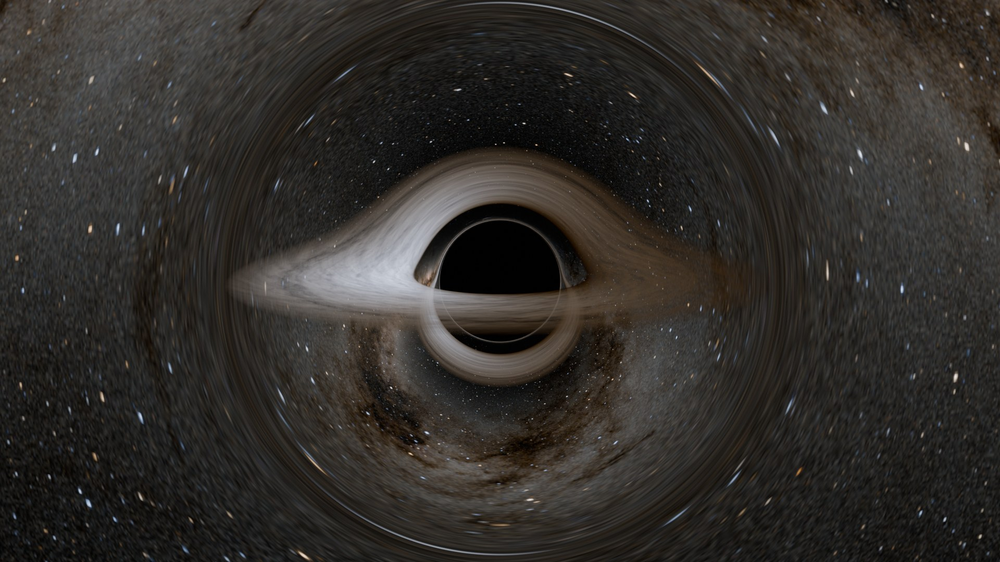

This breakdown is for technical artists and developers who want to know how it works. Every section has three parts:

- **Principle:** the idea, with no maths.
- **Approach:** what the code actually does.
- **Equations:** the maths, for anyone who wants to check it.

The add-on is about 3,600 lines (3,250 of Python, 340 of OSL), plus a test suite of 51 tests that checks the shader maths against an independent ray tracer written in NumPy.

## 1 · Units: why every black hole looks the same

### Principle

A black hole's shape depends on one number: its size. Measure everything in multiples of that size and every non-spinning black hole looks identical. A hole a million times heavier is a million times bigger, and the picture just scales up.

### Approach

Every length inside the add-on is measured in **r\_s**, the Schwarzschild radius, the radius of the event horizon of a non-spinning hole. The physics never sees metres or Blender units. Two settings convert at the edges:

- **Scale (BU per r\_s)** turns r\_s into Blender units, so you decide how big the hole is in your scene.
- **Mass** only feeds an info line that tells you the real size in kilometres or AU. Sagittarius A\*, the default at 4.3 million solar masses, has r\_s of about 12.7 million km.

### Equations

General relativity is usually written with G = c = 1, which leaves mass as the only scale. The Schwarzschild radius is

```math
r_s = \frac{2GM}{c^2}
```

Setting r\_s = 1 makes M = 0.5. Every landmark is then a fixed number: the photon sphere at r = 1.5, the shadow's edge at b = 2.598, the innermost stable orbit at r = 3 for a non-spinning hole.

## 2 · How light bends

### Principle

Light passing a black hole curves towards it. Far away the curve is gentle. Close in it gets dramatic: a ray can loop all the way around the hole and come back out, and a ray that comes too close falls in for good. One equation describes every one of these paths.

### Approach

A light ray around a non-spinning hole always stays in one flat plane, the plane containing the ray and the hole's centre. Inside that plane the path can be written as distance against angle. The only thing that tells two rays apart is the **impact parameter** b: how far from the centre the ray would pass if there were no gravity at all.

So the whole 3D problem shrinks to a 2D curve that depends on a single number. That is what makes Fast mode possible.

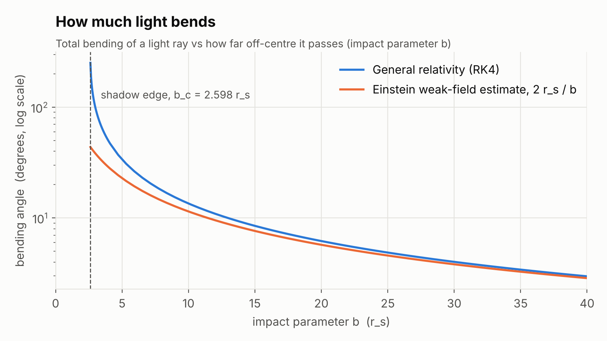

### Equations

Write u = 1/r and let φ be the angle around the hole in the ray's plane. The Schwarzschild photon orbit equation, in units where r\_s = 1, is

```math
\frac{d^2u}{d\varphi^2} = -u + \frac{3}{2}\,k\,u^2
```

The −u term alone gives a straight line. The 1.5 k u² term is general relativity, and k is the **Lensing Strength** slider (1 is real physics, 0 switches bending off).

A ray coming in from infinity starts with

```math
u(0) = 0, \qquad \frac{du}{d\varphi}(0) = \frac{1}{b}
```

Far from the hole this predicts the classic deflection of about 2 r\_s / b, which is the same formula used for starlight bending around the Sun.

## 3 · Tracing a ray: RK4

### Principle

The bending equation has no neat answer you can just write down, so the computer walks along the ray in small steps. At each step it asks "which way is the path curving here?" and moves a little. Runge–Kutta 4 (RK4) is a clever way of asking that question four times per step, which keeps the path accurate with fairly large steps.

### Approach

The same RK4 loop exists in three places, and they are tested against each other:

- **`lut.py`** traces 1024 rays at once with NumPy to bake the Fast mode table, 8 sub-steps per table row.
- **`blackhole_geodesic.osl`** traces each camera ray in Exact mode, 256 steps per full turn by default (**Steps / Orbit**).
- **`tests/reference_tracer.py`** is an independent tracer the tests use as ground truth.

A ray stops when u drops to 0 (it escaped to infinity) or reaches 1 (it crossed the horizon). The exact crossing angle is found by linear interpolation inside the last step.

### Equations

RK4 needs first-order equations, so the second-order orbit equation is split in two, with w = du/dφ:

```math
\frac{du}{d\varphi} = w, \qquad \frac{dw}{d\varphi} = -u + \frac{3}{2}k u^2
```

For a step h, with f the right-hand side, RK4 takes four samples and averages them:

```math
\begin{aligned}
k_1 &= f(y_n) \\
k_2 &= f(y_n + \tfrac{h}{2}k_1) \\
k_3 &= f(y_n + \tfrac{h}{2}k_2) \\
k_4 &= f(y_n + h\,k_3) \\
y_{n+1} &= y_n + \tfrac{h}{6}(k_1 + 2k_2 + 2k_3 + k_4)
\end{aligned}
```

The error per full orbit shrinks with h⁴, so halving the step makes the path about 16 times more accurate.

## 4 · The shadow and the photon sphere

### Principle

At 1.5 r\_s light can orbit the hole in a circle. That radius is the **photon sphere**. Any ray aimed closer than a certain distance spirals in past it and is lost, so from far away you see a black disc about 2.6 times the horizon's radius. That disc is the **shadow**. Rays that just miss it wrap around the hole one or more times before escaping, and pile up into a thin bright ring at its edge, the **photon ring**.

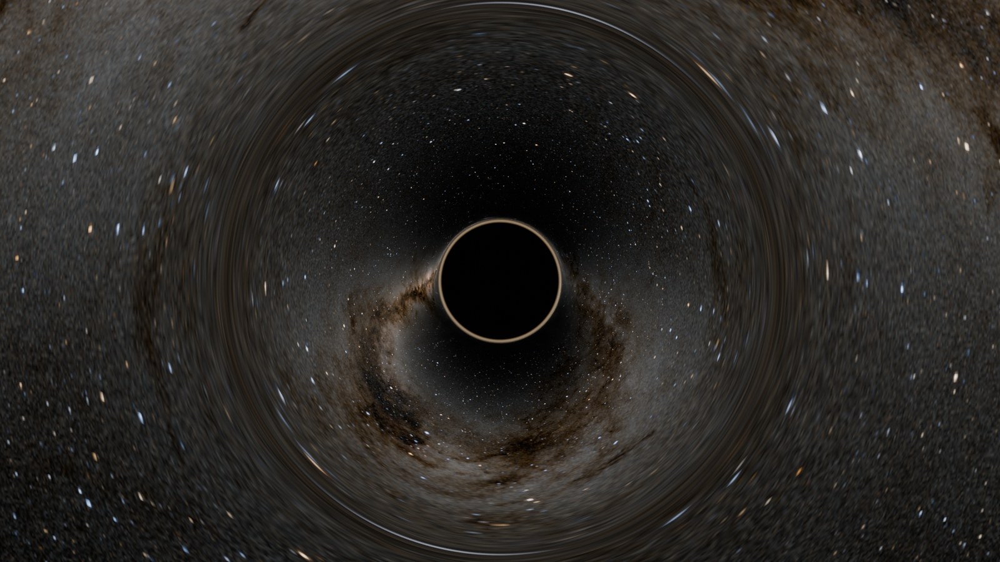

### Approach

The add-on never draws a shadow. It only traces rays: the ones that cross the horizon return no light, and the black disc appears by itself. The same is true of the photon ring and of the bent copy of the disk that appears above and below the shadow. They are all just rays doing what the equation says.

The periapsis (closest approach) of each ray matters later, for the lookup table, so the add-on computes it two ways: by bisection in Python, and in closed form inside the shader nodes. The tests check that the two agree.

### Equations

Multiply the orbit equation by du/dφ and integrate once. This gives a conserved quantity:

```math
\left(\frac{du}{d\varphi}\right)^2 = \frac{1}{b^2} - u^2 + k\,u^3
```

The ray turns around where the left side reaches zero, so the periapsis u is the smallest positive root of

```math
k\,u^3 - u^2 + \frac{1}{b^2} = 0
```

The function u² − u³ (for k = 1) has its maximum 4/27 at u = 2/3, which is r = 1.5, the photon sphere. If 1/b² is bigger than 4/27 there is no turning point and the ray falls in. So the critical impact parameter is

```math
b_c = \sqrt{\tfrac{27}{4}} = \tfrac{3\sqrt{3}}{2} \approx 2.598\ r_s
```

The shader solves the cubic with the trigonometric formula, which needs no loops:

```math
u_{peri} = \frac{1}{3k}\left[1 + 2\cos\!\left(\tfrac{1}{3}\arccos\!\left(1 - \tfrac{27k^2}{2b^2}\right) - \tfrac{2\pi}{3}\right)\right]
```

## 5 · Fast mode: the lookup table

### Principle

Since every ray's path depends only on b, you can trace all of them once and save the answers in a picture. Each column of the picture is one ray, each row is an angle along it, and the pixel stores how far from the hole the ray is at that angle. Rendering then becomes "look up the right pixel", which a GPU does in nanoseconds.

### Approach

When you add a black hole, `lut.compute` traces 1024 rays in parallel with NumPy and writes a 1024 × 512 float image packed into the .blend file. The four channels each hold a different table:

| Channel | Holds | Used for |
| --- | --- | --- |
| R | u = 1/r at angle θ along the ray | where the ray is at any angle |
| G | total angle swept, signed (+ escaped, − captured) | did the ray escape, and where it ends |
| B | unused |  |
| A | the inverse: the angle at which the ray reaches a given u | where a ray starting at the camera is on its orbit (section 6) |

Rows cover 0 to 3π, enough for the direct image, the image that wraps once behind the hole, and the photon ring. After a ray escapes or falls in, R stores a marker value (−0.05 or 2.0) so the shader can tell.

The columns are not evenly spaced in b. Most of the detail sits near the shadow edge, where paths change fastest, so the mapping squeezes columns there. The image is also flagged as Non-Color data so Blender never applies a colour transform to the numbers.

The table is rebuilt only when the influence radius or lensing strength changes. Every other slider just sets a value node, which is instant.

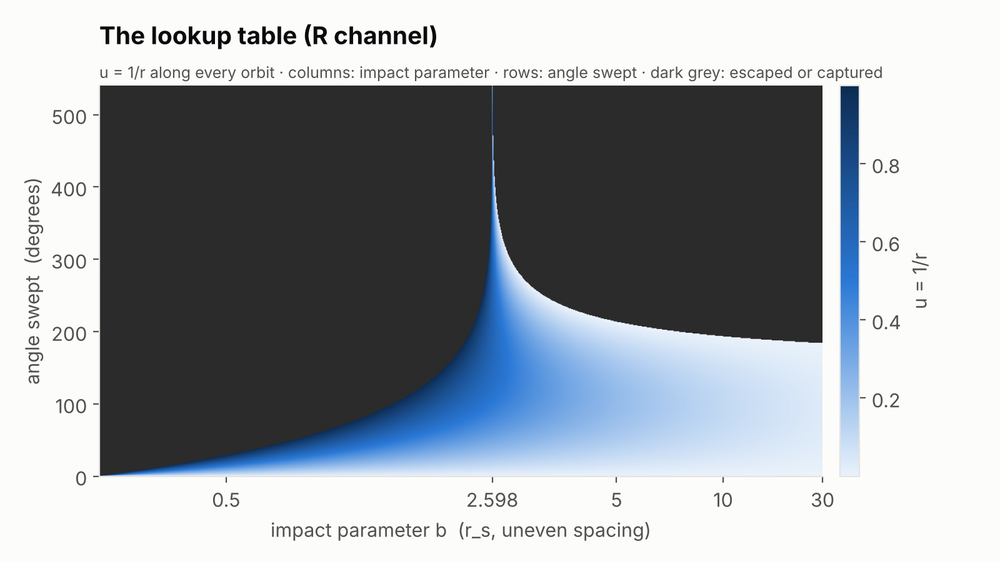

### Equations

With s = b\_c and b\_max = 1.05 × the influence radius, the texture coordinate x of an impact parameter b is

```math
x(b) = \frac{b}{b + s}\cdot\frac{b_{max} + s}{b_{max}}
```

This is a hyperbola: half of all columns go to b below about b\_c, which is where the photon ring lives. Bilinear filtering between neighbouring texels is the only approximation, and the tests measure it against the reference tracer.

## 6 · Starting from the camera: the inverse table

### Principle

The main table describes rays coming in from far away. But the camera can be anywhere, even inside the sphere close to the hole. So for each pixel the shader has to find where on its orbit the camera sits. The alpha channel answers that: given a distance, at what angle does the ray reach it?

### Approach

For each camera ray the shader:

1. Works out the ray's b from the camera position and direction.
2. Computes the periapsis u\_max with the closed-form cubic (section 4), or uses the horizon (u = 1) for a ray that falls in.
3. Looks up the camera's angle θ\_c on the orbit in the alpha channel.
4. If the ray is heading outwards, uses the mirror half of the orbit: an escaping orbit is symmetric about its periapsis, so the angle is θ\_end − θ\_c.

The camera's own angle also tells the shader which part of the path lies in front of the camera, so a disk behind the camera is not drawn.

### Equations

Near the periapsis u barely changes while θ races along. Stored directly, the angle would have a vertical tangent there, and linear interpolation would be badly wrong. The fix is a change of variable. Near the turning point

```math
u_{max} - u \;\propto\; (\theta - \theta_{peri})^2
```

so θ is a straight line in √(u\_max − u). The rows are laid out in

```math
y = 1 - \sqrt{1 - u/u_{max}}
```

which puts the first row exactly at u = 0 (infinity) and the last exactly at the periapsis. Interpolating in that variable is accurate right up to the turning point.

## 7 · From a 2D curve back to 3D

### Principle

The table only knows distance against angle, in a flat plane. To place the ray in the scene, the shader builds two arrows that lie in the ray's plane, at right angles to each other. Any point on the path is then "this far along arrow A, this far along arrow B", scaled by the distance from the table.

### Approach

From the camera position and the ray direction the shader builds:

- **n**, the unit vector from the hole to the camera,
- **t**, the part of the ray direction at right angles to n.

Both lie in the ray's plane. It then rotates them by −θ\_c, so that θ = 0 points along the ray's incoming direction at infinity. That gives two fixed vectors A and B, and every point on the path, including its final direction at infinity, follows from one cosine and one sine.

The last step uses the same basis: the escaping direction is A cos θ\_end + B sin θ\_end, transformed back to world space and used to look up the sky image.

### Equations

```math
\begin{aligned}
\mathbf{A} &= \mathbf{n}\cos\theta_c - \sigma\mathbf{t}\sin\theta_c \\
\mathbf{B} &= \mathbf{n}\sin\theta_c + \sigma\mathbf{t}\cos\theta_c \\
\mathbf{P}(\theta) &= r(\theta)\,\big(\mathbf{A}\cos\theta + \mathbf{B}\sin\theta\big)
\end{aligned}
```

At θ = θ\_c this gives P = r\_c n, the camera, moving along σt. The sign σ = ±1 handles the one awkward case: a ray heading away from a hole it is already falling into, which has to walk the table backwards.

## 8 · Hitting the disk

### Principle

The disk is flat and lies in the hole's equator. The ray's plane is also flat and passes through the centre, so the two planes cut each other along a line through the centre. The ray can only hit the disk where it crosses that line, and it crosses it every half turn. That is why you see the disk once directly, once bent over the top of the shadow, and once more as a thin ring.

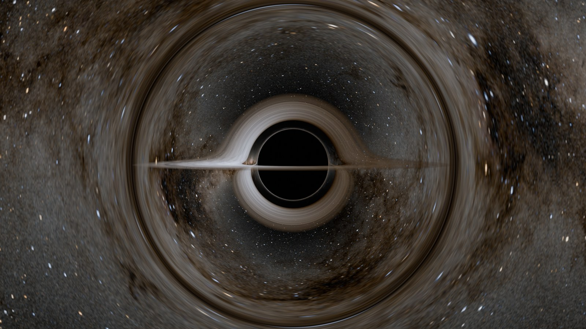

### Approach

The shader finds the first angle where the path meets the disk plane, then adds π twice more. For each of the three angles it reads r from the table and checks that the ray was still in flight and inside the sphere at that point. Each valid hit is shaded by the shared **disk group** (temperature, colour, redshift, texture, turbulence) and composited front to back:

- the first hit is drawn with its own opacity,
- each later hit is dimmed by everything in front of it.

The second and third hits get the **Photon Ring Boost** multiplier, so artists can brighten the ring without touching the rest of the disk.

Exact mode does the same thing differently: its RK4 loop notices when z changes sign between two steps and records the crossing. Both modes then hand the hits to the same disk group, so a disk texture looks identical in both.

### Equations

With the basis from section 7, the height of the path above the disk is

```math
z(\theta) = r(\theta)\,\big(A_z\cos\theta + B_z\sin\theta\big)
```

r is never zero, so z = 0 exactly where the bracket is zero:

```math
\theta_0 = \operatorname{atan2}(-A_z,\;B_z), \qquad \theta_k = \theta_0 + k\pi
```

The crossings do not depend on how much the ray bends, only on the plane it lives in. The bending only decides how far out each crossing is, and that comes from the table.

## 9 · The disk's inner edge: the ISCO

### Principle

Gas can orbit a black hole in circles, but not too close. Below a certain radius any small nudge sends it spiralling in. That radius is the **innermost stable circular orbit (ISCO)**, and it is where a real disk ends. For a non-spinning hole it is 3 r\_s. A spinning hole drags space round with it, so gas orbiting the same way as the spin can get much closer, and gas orbiting the other way has to stay further out.

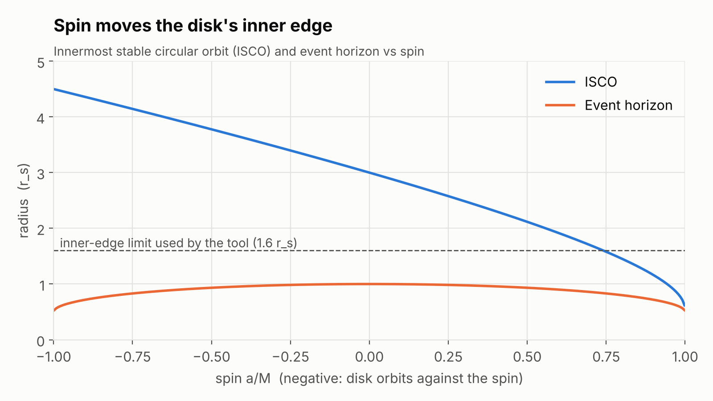

### Approach

With **Inner Edge at ISCO** on (the default), the disk's inner radius follows the spin automatically. The light paths in both modes are Schwarzschild, though, and very close to the hole they stop being a fair stand-in for a spinning one: below the photon sphere at 1.5 r\_s a non-spinning hole has no orbits at all. So the disk's inner edge is clamped just outside it, at 1.6 r\_s. Above a spin of about 0.74, where the true ISCO drops below that, the main panel shows an info line saying the edge is limited and why.

### Equations

Bardeen, Press and Teukolsky (1972) give the ISCO in closed form. With a = spin and lengths in units of M:

```math
\begin{aligned}
Z_1 &= 1 + (1-a^2)^{1/3}\big[(1+a)^{1/3} + (1-a)^{1/3}\big] \\
Z_2 &= \sqrt{3a^2 + Z_1^2} \\
r_{isco} &= 3 + Z_2 \mp \sqrt{(3 - Z_1)(3 + Z_1 + 2Z_2)}
\end{aligned}
```

The minus sign is for a disk orbiting with the spin. Divide by 2 for r\_s units. At a = 0 this gives 6M = 3 r\_s; at a = 1 it falls to M = 0.5 r\_s, and at a = −1 it rises to 9M = 4.5 r\_s. The outer horizon moves in too:

```math
r_+ = M + \sqrt{M^2 - a^2}
```

## 10 · How hot is the disk?

### Principle

Gas falling inwards rubs against itself and heats up, so the disk gets hotter towards the middle. But right at the inner edge the gas stops rubbing and just falls in, so the hottest ring is a little way out from the edge, not at it. Hotter gas glows bluer and much brighter, and that one temperature curve sets both the disk's colour and its brightness.

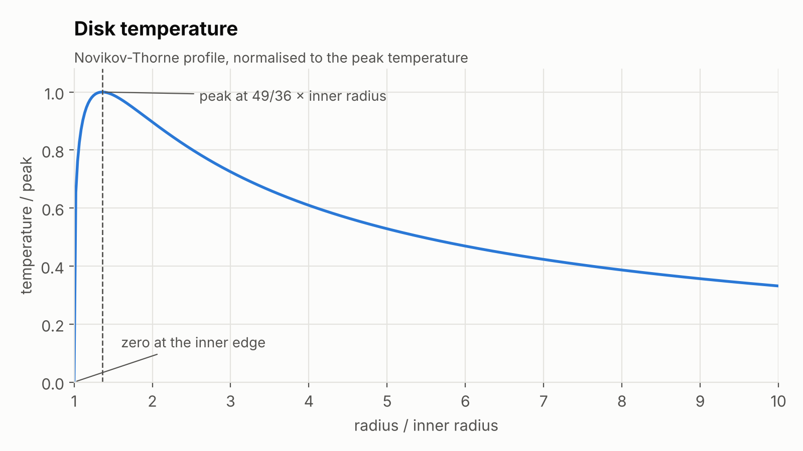

### Approach

The disk group computes the temperature at each hit point from its radius, scaled so the hottest point equals **Peak Temperature**. The temperature then drives two things:

- **Colour:** Blender's Blackbody node turns it into an RGB colour, divided by its own luminance so colour and brightness stay separate. **Physical Color** blends that with the artist's three-colour gradient.
- **Brightness:** (T / T\_peak) to the power of the **Beaming Exponent** (4 by default), after the redshift of section 11 is applied.

The same profile drives the invisible disk-shaped emitter that lights the rest of the scene, so a ship near the hole is lit in the disk's colours.

### Equations

The Novikov–Thorne thin disk (1973) has, far from relativistic corrections,

```math
T(r) \propto r^{-q}\left(1 - \sqrt{\frac{r_{in}}{r}}\right)^{1/4}, \qquad q = \tfrac{3}{4}
```

The bracket is the "stops rubbing at the inner edge" term: it goes to zero at r\_in. Setting the derivative to zero, with x = r / r\_in, the peak is at

```math
x_{peak} = \left(\frac{8q + 1}{8q}\right)^2 = \frac{49}{36} \approx 1.36
```

for q = 3/4. **Temperature Falloff** exposes q for artists. Brightness follows T⁴, the Stefan–Boltzmann law, which is why the inner ring dominates the image.

## 11 · Doppler beaming and redshift

### Principle

The inner disk orbits at around half the speed of light. The side rushing towards you looks bluer and far brighter, and the side moving away looks redder and dimmer. On top of that, light climbing out of the hole's gravity loses energy, so everything close in looks redder and dimmer. One number, **g**, combines both effects: above 1 the light is boosted, below 1 it is dimmed.

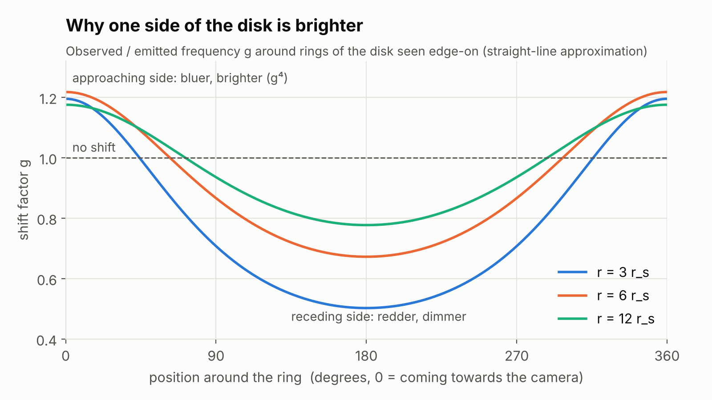

### Approach

For each disk hit the disk group computes the gas's orbital speed and time dilation at that radius, and how much of the photon's motion is around the spin axis. From those it gets g, then:

- multiplies the temperature by g before turning it into a colour (scaled by **Color Shift**),
- multiplies the brightness by g to the power of the **Beaming Exponent**.

**Doppler Beaming** and **Gravitational Redshift** raise each half of g to a power, so 1 is real physics and 0 switches that half off. The Gargantua preset sets both to 0, as the film did.

### Equations

Gas on a circular orbit has angular velocity Ω and time component uᵗ of its four-velocity (in units of M, a = spin):

```math
\Omega = \frac{1}{r^{3/2} + a}, \qquad u^t = \frac{r^{3/2} + a}{r^{3/4}\sqrt{r^{3/2} - 3r^{1/2} + 2a}}
```

A photon with angular momentum L\_z about the spin axis (per unit energy) arrives with

```math
g = \frac{\nu_{obs}}{\nu_{emit}} = \frac{1}{u^t}\cdot\frac{1}{1 - \Omega L_z}
```

The first factor is gravity plus time dilation, the second is the Doppler shift. Observed intensity scales as

```math
I_{obs} = g^4\, I_{emit}
```

The fourth power comes from the invariance of I/ν³ along a ray (ν³) plus one more power for integrating over all frequencies (bolometric). Set the exponent to 3 to get the specific intensity at one frequency instead.

## 12 · Spin: what is exact and what is approximate

### Principle

A spinning black hole drags space around with it. Light paths around it are much harder to calculate, because they no longer stay in one flat plane. The add-on keeps the non-spinning light paths and adds the two most visible effects of spin on top as corrections. Everything the gas does (where the disk ends, how fast it orbits, its redshift) is exact for any spin.

### Approach

| Effect of spin | Treatment |
| --- | --- |
| Inner edge (ISCO), horizon size | Exact (section 9) |
| Orbital speed, time dilation, redshift of the gas | Exact (section 11) |
| Shadow pushed sideways | Approximation: rays are offset sideways in proportion to spin (**Shadow Shift**) |
| Shadow slightly smaller and flattened | Approximation: the shadow radius used for the glow shrinks by 6.7% at full spin |
| Light paths twisted around the axis | Exact mode only: a Lense–Thirring rotation added at each RK4 step (**Frame Dragging**) |

The shadow shift is applied to the ray before the table lookup, in both modes, so both show the same lopsided shadow.

### Equations

The Lense–Thirring angular velocity of space near a spinning hole, on the equator, is

```math
\omega = \frac{2Mar}{r^3 + a^2 r + 2Ma^2}
```

In Exact mode each RK4 step rotates the ray's plane around the spin axis by ω (dt/dφ) h. This captures the twist of the photon ring for a spinning hole, but it is not a full Kerr geodesic: the ray still follows a Schwarzschild orbit inside its slowly turning plane. Kerr ray tracing (Carter's constants and elliptic integrals) is the obvious next step and is listed under Known limitations.

## 13 · The influence sphere and the edge fade

### Principle

In reality a black hole bends light a tiny bit even billions of kilometres away. A renderer cannot shade the whole universe, so the effect lives on a sphere around the hole: only rays that pass through it get bent. If the bending just stopped at the sphere's surface, you would see a circular seam in the stars. So the add-on fades the bending out gently over the sphere's outer part, while rays through the middle keep the full, exact bending.

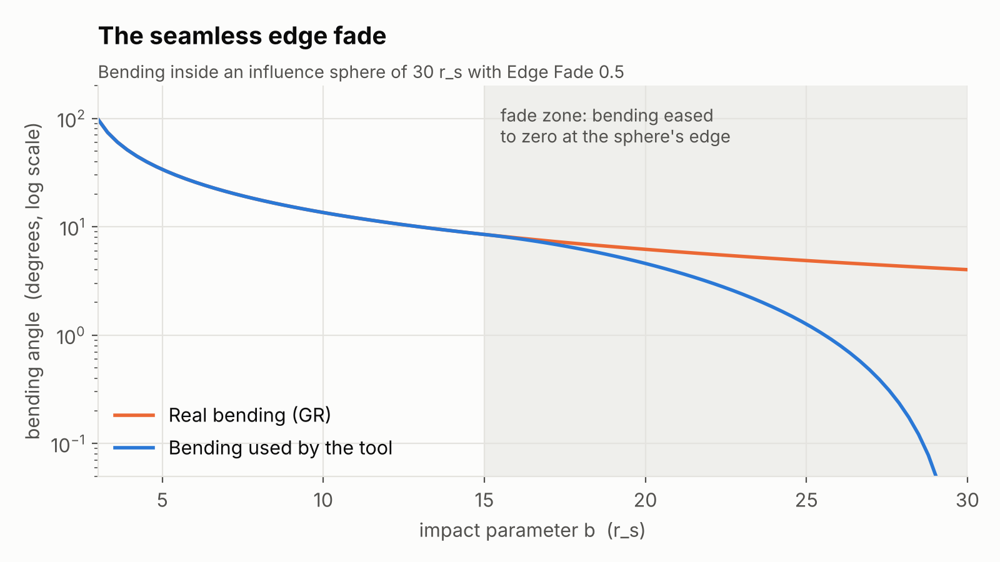

### Approach

The sphere is a real mesh with the lens material on it, **Influence Radius** in radius (30 r\_s by default). For each ray the shader computes the true bent direction at infinity, measures the angle ψ between it and the unbent direction, and scales ψ by a taper factor that depends on b:

- 1 (full bending) for b below the fade radius,
- a smoothstep down to 0 at the sphere's edge.

The fade radius is (1 − **Edge Fade**) × the influence radius, but never less than 6 r\_s, so the strongly bent rays near the shadow are never touched. Rendering the default scene with an influence radius of 30 and of 120 gave identical images, which confirms the fade leaves no visible trace.

The disk and fog must fit inside 90% of the sphere, and jets are capped at its edge. If they don't, the panel warns and says what radius would fit them.

### Equations

The taper on the bending angle is

```math
\psi_{used} = \psi_{GR}\cdot\Big[1 - \operatorname{smoothstep}(r_0,\,R,\,b)\Big], \qquad r_0 = \min\!\big(\max((1-f)R,\;6),\;0.95R\big)
```

with R the influence radius and f the Edge Fade. Since the true bending outside 6 r\_s is already small (about 2/b radians, under 20°), scaling it down smoothly is far less visible than cutting it off.

## 14 · Flying in: the hovering observer

### Principle

By default the camera sees the scene as if space near it were flat. That is fine from far away, but close to the hole a real camera would have to fire rockets just to stay still against the pull. A camera like that sees two strange things: the sky gets bluer and brighter, and the shadow comes out a little smaller than a gravity-blind camera would show, only filling half the sky once you reach the photon sphere. **Hovering Observer** turns this on.

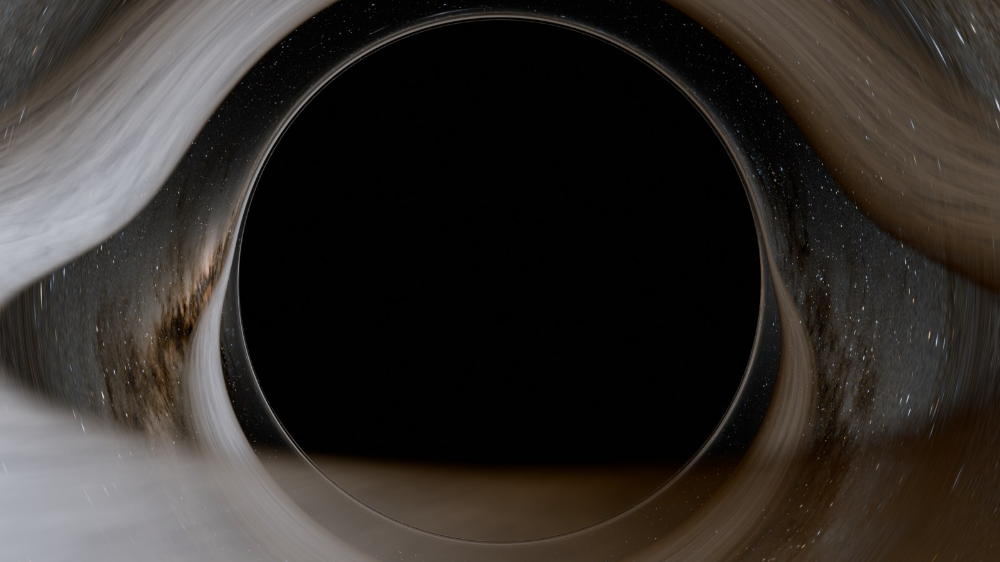

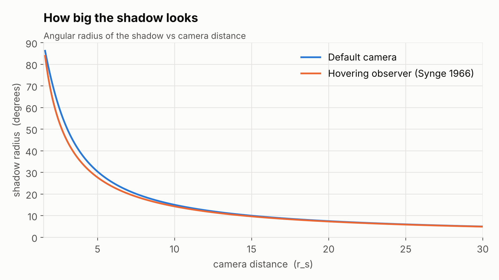

### Approach

Two things change when Hovering Observer is on and the camera is inside the sphere:

- **Aberration:** the camera measures angles in its own local frame, so the same pixel corresponds to a different b. Each pixel maps to a slightly larger b, so fewer pixels fall inside b\_c and the shadow shrinks a little.
- **Blueshift:** light falling into the hole's gravity gains energy. Sky, fog and jets are multiplied by γ⁴ and tinted bluer. The disk already has its own spectrum, so its temperature is shifted by γ directly through g.

The blueshift is measured relative to the sphere's edge, not infinity, so stepping through the sphere's surface causes no jump in brightness.

### Equations

A static observer at radius r who sees a ray at angle α from the radial direction assigns it the impact parameter

```math
b = \frac{r\sin\alpha}{\sqrt{1 - 1/r}}
```

The shadow's edge is where b = b\_c, which gives Synge's (1966) angular radius of the shadow:

```math
\sin\alpha_{sh} = \frac{b_c\sqrt{1 - 1/r}}{r}
```

At r = 1.5, the photon sphere, α = 90° and the shadow fills half the sky. The frequency boost between the sphere's edge R and the camera at r is

```math
\gamma = \sqrt{\frac{1 - 1/R}{1 - 1/r}}
```

and bolometric brightness goes up by γ⁴, for the same reason as in section 11.

## 15 · Fog and thick disks

### Principle

A thin disk is a surface: the ray hits it or not. Fog and a thick disk are volumes: the ray picks up a little glow and loses a little light all the way through. The add-on walks along the curved light path in short straight pieces and adds up what each piece contributes, so the fog is bent by the hole like everything else.

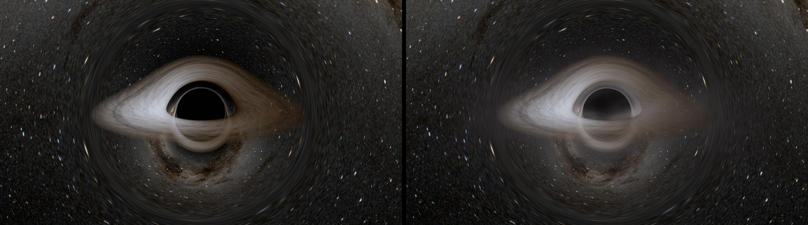

*Left: fog off · Right: fog on*

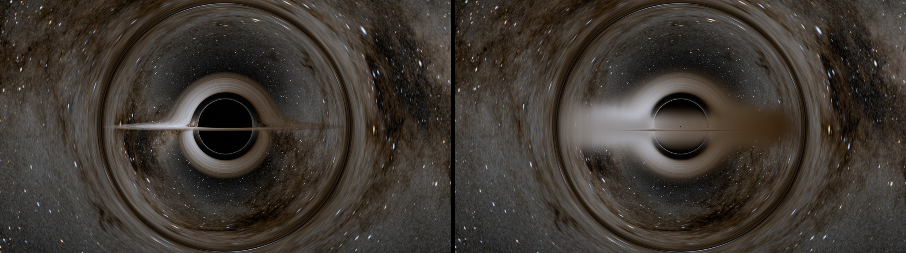

*Left: thin disk · Right: thickness 0.1, edge-on*

### Approach

The path inside the sphere is cut into N segments (**Volume Quality**: 8 to 48), evenly spaced in orbital angle. Fast mode reads each point from the table, Exact mode records them during RK4. Each segment is one instance of a **step node group** that:

1. samples the fog at its midpoint (density, glow, dust absorption, 3D noise that orbits at the Keplerian rate),
2. for a thick disk, integrates the disk's density across the segment in closed form,
3. adds the light it emits, dimmed by everything in front of it, and updates the remaining transmittance.

Even sample spacing makes visible bands, so the inner points are jittered by a per-pixel random offset. Banding turns into fine noise, which Blender's sampling and denoiser average away.

The chain of step groups needed two tricks to compile in Cycles, covered in section 17.

### Equations

Light through a medium follows the Beer–Lambert law. Over a segment with optical depth τ the light behind is multiplied by e^(−τ), and front-to-back compositing gives

```math
C \mathrel{+}= T\cdot E_j, \qquad T \mathrel{*}= e^{-\tau_j}
```

The thick disk is a Gaussian slab with scale height H(r) = thickness · r · (r / r\_in)^flare and unit column density:

```math
\rho(z) = \frac{1}{\sqrt{2\pi}\,H}\,e^{-z^2/2H^2}
```

Along a straight segment from height z₀ to z₁ of length Δs the integral is exact:

```math
\int \rho\,ds = \Delta s\,\frac{\lvert\Phi(z_1/H) - \Phi(z_0/H)\rvert}{\lvert z_1 - z_0\rvert}
```

where Φ is the normal CDF. This is the key idea: a disk thinner than one segment is never missed, because the integral counts it wherever the segment crosses it. Shader nodes have no erf, so Φ uses the tanh approximation (error under 0.0002):

```math
\Phi(x) \approx \tfrac12\Big[1 + \tanh\!\big(0.79788\,(x + 0.044715\,x^3)\big)\Big]
```

The disk's existing opacity α becomes a face-on optical depth τ₀ = −ln(1 − α), so a thick disk seen face-on is exactly as opaque as the thin one.

## 16 · Exact mode: the OSL tracer

### Principle

Exact mode skips the table and traces every camera ray from scratch, in a small program that Cycles runs for every pixel sample. It is slower and CPU only, but it can do things a table cannot: frame dragging that twists the path, and jets that glow along the curved path rather than a straight line.

### Approach

`blackhole_geodesic.osl` is about 340 lines of Open Shading Language. For each shading point it:

1. Works out where the ray started (the camera, or the previous bounce in Cycles) and its b, including the hovering-observer correction.
2. Runs the RK4 loop, 256 steps per turn by default, for up to **Max Orbits** turns plus half a turn for the stretches outside the sphere.
3. Records up to three disk crossings, collects jet light between them, and stops at the horizon or when the ray escapes far away.
4. Returns the hits, the jet light, the bent exit direction and a few scalars (b, L\_z, γ) as output sockets.

It does **only** the relativity. The disk's look (temperature, colour, texture, turbulence) is shaded by the same node groups Fast mode uses, wired to the script's outputs. That keeps the two modes visually identical and means a disk texture or colour ramp works in both.

**Volumes need a variable number of outputs.** OSL has no output arrays that Blender can expose as sockets, so the add-on generates the shader text. The source file contains two markers, `/*@PATH_DECL@*/` and `/*@PATH_ASSIGN@*/`. Before compiling, Python replaces them with N + 1 output declarations `Path0 … PathN` and the code that fills them from the recorded path, and adds `#define PATH_SAMPLES N` at the top. Each sample count gets its own text block, compiled with `cycles.osl.update_script_node` so the sockets exist immediately.

### Equations

The path is recorded at most 1024 times along the trace. The N + 1 output points are then interpolated from that record at evenly spaced orbital angles, with the same per-pixel jitter as Fast mode:

```math
P_j = \operatorname{lerp}\big(\text{rec}[i_0],\,\text{rec}[i_0+1],\,f - i_0\big), \qquad f = \frac{(j + \xi_j)\,\text{span}}{N}
```

with ξ\_j the jitter (0 at both ends, so the path still starts at the camera and ends at the exit point).

## 17 · Writing shaders as Python: nodemath

### Principle

Fast mode's shader runs to hundreds of nodes, and many more with volumes on. Nobody could wire that by hand. Instead the add-on writes the maths as ordinary Python, like `r = g.length(pos)`, and a small library turns each `+`, `*` or `sqrt` into the matching Blender node and connects it. The result is a real node tree you can open and inspect, with no Python running at render time.

### Approach

`nodes/nodemath.py` (about 270 lines) has two classes:

- **`Sock`** wraps one node output. It overloads Python's operators (`+ - * / **`, unary minus), so `a * b + 1.0` builds a Multiply node and an Add node. Plain numbers are folded into the node's input value rather than creating extra nodes.
- **`Graph`** owns the node tree and provides the rest: `sqrt`, `atan2`, `dot`, `cross`, `lerp`, `smoothstep`, `noise`, `blackbody`, `image`. It also lays nodes out in columns so the generated tree stays readable.

**Parameters are named Value nodes.** `g.param("PeakTemp", 7000)` creates a Value node named `PeakTemp`. When the user moves a slider, `params.shader_values` maps the setting to that name and `builder.apply` writes the new number into the node. No rebuild, no recompile: changing a slider is instant. Only structural changes (render mode, Volume Quality) rebuild the tree. Influence radius and lensing strength re-bake the lookup table, which takes about a second.

Repeated pieces (the disk shading, the fog sample, one volume step) are built once as **node groups** and instanced, which keeps build time low.

### The SVM stack problem

Cycles compiles node trees into a small virtual machine (SVM) with a fixed stack of 255 slots for intermediate values. A long volume chain blew through it. Two fixes made it fit:

1. **Dependency chain.** Every value in a step group is tied to the incoming transmittance by adding transmittance × 10⁻³⁰. Numerically this changes nothing, but it forces Cycles to evaluate each step strictly after the previous one, so values don't pile up on the stack.
2. **The seal.** Blender 5's compiler finishes one dependency chain before starting the next. With four separate accumulators (colour, fog glow, transmittance, fog-before-hits) it would run one all the way to the end while holding the others. Every output of a step is made to depend on all four, again × 10⁻³⁰, so the four advance together one step at a time.

## 18 · Fitting into Blender

### Principle

The physics is only half the job. The rest is making it behave like a normal Blender tool: settings that save with the file, sliders that update live, undo that works, presets, a sidebar, and animation that plays without any scripts running.

### Approach

| Piece | How it's done |
| --- | --- |
| Settings | A `PropertyGroup` attached to every Object as `obj.blackhole`, filled in only on the black hole's root empty. Saved in the .blend like any other property. |
| Live updates | Every property has an update callback. Most call `builder.apply`, which only writes values into named nodes. Render mode and Volume Quality call `builder.rebuild`, which regenerates the node trees. |
| Presets | Reset every property to its default, then apply the preset's values. A temporary `_bhs_suspend` flag stops about 100 update callbacks firing one by one; one `apply` runs at the end. Scene-specific settings (sky, mass, camera distance) are skipped. |
| Objects | A root empty, the lens sphere with its material, an invisible disk-shaped emitter for scene lighting, and helper markers. Removing the black hole deletes them all plus its table image. |
| Animation | A driver with the expression `frame` feeds the current frame into a `Time` value node. Blender evaluates simple expressions like this without Python, so it works with scripts disabled and on render farms. |
| World | **Use Matching World** creates a new World called "BHS Sky" with the same sky shader, and keeps the old World with a fake user so it is never lost. |
| Compositor | Bloom and chromatic aberration. Blender 4.x uses the scene's own compositor tree; 5.x assigns a compositor node group, so there are two code paths. |
| Versioning | Each black hole stores the version of the node trees it was built with. If an update changes them, it rebuilds on the next change. |

The bundled sky and disk images are packed into the .blend when a black hole is created, so files open on any machine without the add-on's texture folder.

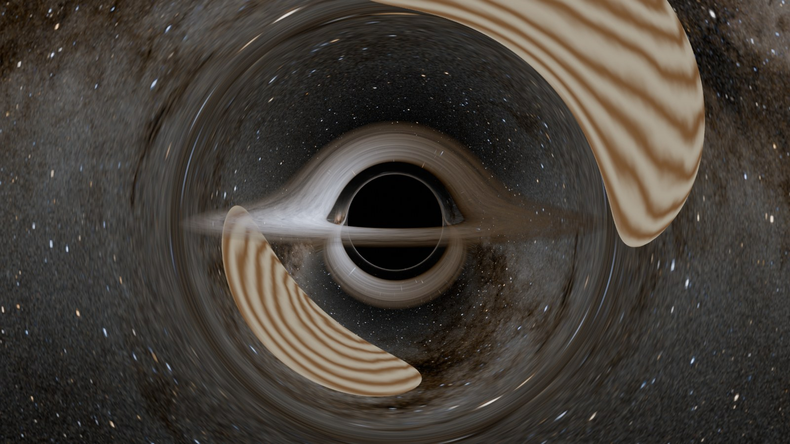

### Lens Scene Objects

To bend real objects instead of only the sky image, the lens sphere switches to a **refraction** shader with a fake surface normal. Snell's law is run backwards: given the incoming direction d and the desired bent direction d′, the normal that makes a glass of index η refract d into d′ is

```math
\mathbf{N} \propto \mathbf{d} - \eta\,\mathbf{d}'
```

With η = 4 this can steer rays by up to about 75°. Rays bent further than that fall back to the sky image. Cycles then traces the refracted ray into the scene, so planets and ships behind the hole show up lensed.

## 19 · Testing, and the bug the tests missed

### Principle

Shader bugs are hard to see: a slightly wrong number just looks like a slightly different picture. So the maths is tested outside Blender against an independent tracer, and a separate script builds real scenes inside Blender and checks nothing breaks. One bug still got through, and it is a good example of why GPU maths needs care.

### Approach

**Unit tests (pytest, 51 tests, no Blender needed).** `physics.py`, `lut.py` and `volume.py` import no `bpy`, so they run in plain Python. The tests check, among other things:

- the RK4 table against `reference_tracer.py`, a separate tracer, for many b and θ,
- the closed-form periapsis against bisection,
- that every escaping ray's total bending matches the known weak-field limit far out,
- ISCO and temperature-peak values against published numbers,
- the slab integral against brute-force numerical integration, including disks much thinner than a segment,
- `fast_reference.py`, a NumPy copy of the whole Fast mode node graph, against the reference tracer for cameras inside and outside the sphere.

**Smoke test (inside Blender).** `scripts/smoke_test.py` runs Blender in the background, adds black holes, applies every preset, switches modes and settings, checks a version-mismatch rebuild, renders small frames and checks for errors. It finished with 0 failures on Blender 5.2.

### The Eevee NaN bug

In Eevee the disk, jets and glow were cut off beyond a fixed circle around the hole. Cycles looked fine.

The cause was the horizon glow, which is only meant to show inside the shadow:

```math
\text{glow} = \text{inside}\cdot e^{-(b_{sh} - b)/2w}
```

Outside the shadow, "inside" is 0, so the result should be 0. But outside the shadow b is larger than b\_sh, so the exponent is positive, and with the default width of 0.15 it passes 88 once b goes above about 29 r\_s, and e⁸⁸ overflows a 32-bit float to infinity. Then 0 × ∞ = NaN, and a NaN anywhere in the sum blanks the whole pixel. Cycles happens to handle that case more gracefully, so only Eevee showed it.

The fix clamps the exponent so it can never go above 0:

```math
\text{glow} = \text{inside}\cdot e^{-\max(b_{sh} - b,\,0)/2w}
```

The lesson: on a GPU, "multiply by zero to switch it off" is only safe if the other factor is finite.

## Known limitations

These are deliberate trade-offs, listed so nobody mistakes them for the full physics.

- **Light paths are Schwarzschild.** Spin is exact for the gas (ISCO, orbital speed, redshift) but approximate for light: a sideways shadow shift, a fitted shadow size and, in Exact mode only, a Lense–Thirring twist. Full Kerr ray tracing is the natural next step.
- **Disk inner edge clamped at 1.6 r\_s.** Above a spin of about 0.74 the real ISCO is closer in. The panel says so when it happens.
- **Thin-disk physics only.** The temperature follows Novikov–Thorne. Thick disks and fog use that same temperature and are an artistic model, not a simulation of a hot, puffed-up flow.
- **Fast mode jets are straight.** Jets are drawn along unbent lines, and "behind the disk" is decided by which side of the disk plane the jet point is on. Exact mode accumulates jets along the curved path.
- **Fast mode camera inside 1.5 r\_s.** Inside the photon sphere the table approach is less accurate. The panel recommends Exact mode there.
- **Hovering observer and Lens Scene Objects.** The blueshift boost is applied to the sky, fog and jets the lens shader draws, not to scene objects seen through the refraction.
- **Lens Scene Objects is Cycles only,** and rays bent by more than about 75° fall back to the sky image.
- **Exact mode is CPU only,** as the add-on sets it up. Blender can also run OSL on NVIDIA OptiX, but that path is untested.
- **Influence sphere.** Outside it there is no bending at all, and inside its outer part bending is tapered. With the default settings this is invisible (section 13), but a camera far outside a small sphere sees slightly less bending of the distant stars than GR predicts.

## FAQ

Short answers to the questions people ask most, in plain words.

**Q.** Is this physically accurate?\
**A.** For a non-spinning hole, yes: the light paths are exact general relativity, up to the resolution of the table (Fast) or the step size (Exact). For spinning holes the gas is exact and the light paths are approximate (section 12).

**Q.** Why does the far side of the disk appear above the shadow?\
**A.** Light from the back of the disk that would have gone over the top of the hole is bent down towards you. You are seeing the back of the disk, lensed over the top. The same happens underneath.

**Q.** Why is one side of the disk brighter?\
**A.** That side is moving towards you at a large fraction of the speed of light, so its light is beamed forward and boosted (section 11).

**Q.** What is the thin ring at the shadow's edge?\
**A.** The photon ring: light that circled the hole once or more before escaping. Each extra loop makes a thinner, fainter copy.

**Q.** Why a lookup table instead of tracing every ray?\
**A.** Every ray around a non-spinning hole is the same 2D curve, picked by one number (b). Tracing 1024 of them once and reading the answer back is thousands of times cheaper per pixel, and it runs in Eevee and on any GPU.

**Q.** Why store the inverse in √(u\_max − u)?\
**A.** At the closest approach the angle changes fast while the distance barely changes. In that variable the curve is a straight line, so simple interpolation stays accurate (section 6).

**Q.** Why integrate the thick disk with the normal CDF instead of sampling it?\
**A.** Sampling can step right over a thin disk. Integrating the Gaussian exactly over each straight segment counts it wherever it is (section 15).

**Q.** What is the influence sphere, and why does it fade?\
**A.** The region where bending is computed. Fading the bending near its edge avoids a visible seam where the bending would otherwise stop suddenly (section 13).

**Q.** Why does mass not change the picture?\
**A.** In general relativity mass only sets the scale. Measured in r\_s, every non-spinning black hole looks the same (section 1).

**Q.** What does "hovering observer" mean?\
**A.** A camera holding still near the hole by firing rockets. It sees a bluer, brighter sky and a slightly smaller shadow than a camera that ignores gravity (section 14).

**Q.** Why Python for the node trees?\
**A.** The Fast shader is hundreds of nodes. Writing the maths as Python expressions that generate nodes keeps it readable, testable against NumPy, and still runs with no Python at render time (section 17).

**Q.** What was the hardest bug?\
**A.** An infinity times zero in the horizon glow that blanked pixels in Eevee only (section 19).

**Q.** Why does the volume shader multiply things by 10⁻³⁰?\
**A.** To force Cycles to evaluate the volume steps in order, so its 255-slot shader stack doesn't overflow. The number is too small to change any result (section 17).

## References

- Bardeen, Press & Teukolsky (1972). *Rotating black holes: locally nonrotating frames, energy extraction, and scalar synchrotron radiation.* ApJ 178, 347. [ADS](https://ui.adsabs.harvard.edu/abs/1972ApJ...178..347B) · ISCO, orbital velocity, uᵗ
- Novikov & Thorne (1973). *Astrophysics of black holes.* In *Black Holes (Les Astres Occlus)*, Gordon & Breach · thin-disk temperature
- Shakura & Sunyaev (1973). *Black holes in binary systems: observational appearance.* A&A 24, 337. [ADS](https://ui.adsabs.harvard.edu/abs/1973A&A....24..337S) · thin-disk model
- Synge (1966). *The escape of photons from gravitationally intense stars.* MNRAS 131, 463. [ADS](https://ui.adsabs.harvard.edu/abs/1966MNRAS.131..463S) · shadow size for a static observer
- Luminet (1979). *Image of a spherical black hole with thin accretion disk.* A&A 75, 228. [ADS](https://ui.adsabs.harvard.edu/abs/1979A&A....75..228L) · the first computed image, same setup as Physical Default
- James, von Tunzelmann, Franklin & Thorne (2015). *Gravitational lensing by spinning black holes in astrophysics, and in the movie Interstellar.* Classical and Quantum Gravity 32, 065001. [ADS](https://ui.adsabs.harvard.edu/abs/2015CQGra..32f5001J) · the Gargantua look, and why Doppler was switched off
- Event Horizon Telescope Collaboration (2019). *First M87 Event Horizon Telescope Results. I.* ApJL 875, L1. [ADS](https://ui.adsabs.harvard.edu/abs/2019ApJ...875L...1E) · the EHT preset
- NASA Scientific Visualization Studio (2020). [*Deep Star Maps 2020*](https://svs.gsfc.nasa.gov/4851) · the bundled Milky Way sky (Hipparcos-2, Tycho-2, Gaia DR2)
- Source code: [github.com/paraminder-dhiman/black-hole-studio](https://github.com/paraminder-dhiman/black-hole-studio)
